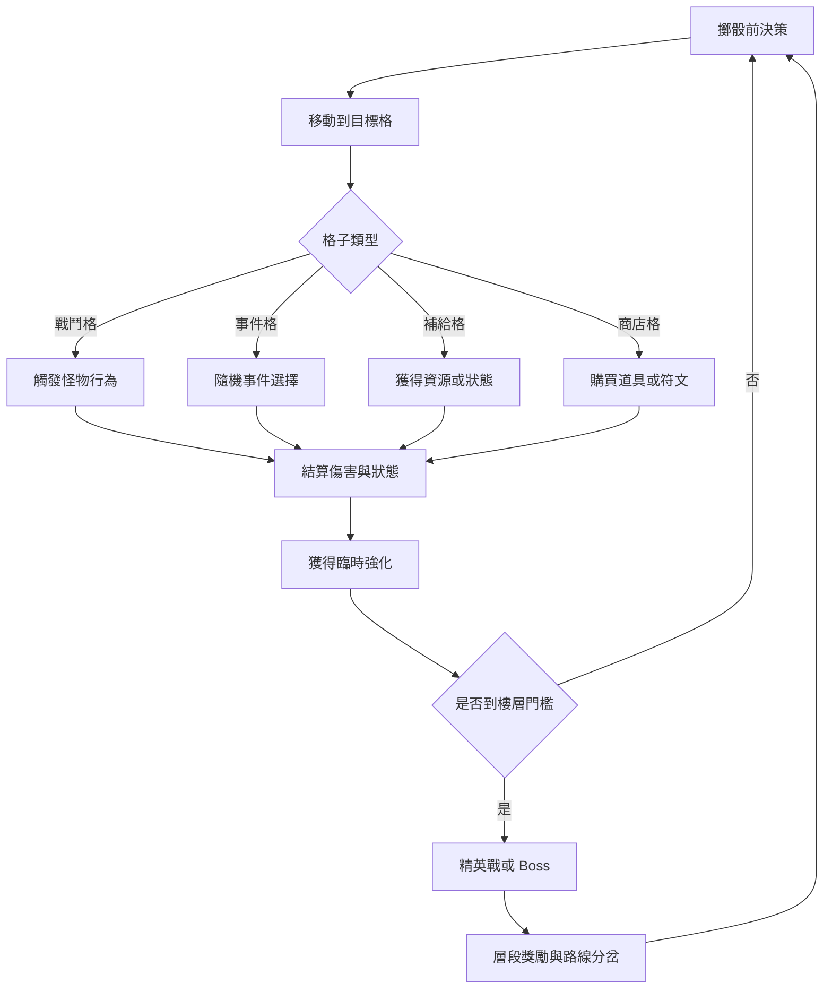

# 怪獸塔 Gen3 設計稿 v0.1

## 1. 產品願景
打造一個「有立體空間感、節奏明快、每一局都像在爬一座活著的玩具塔」的回合制爬塔遊戲。

三個核心目標：
- 立體感：2.5D 視覺深度與一致光影規則。
- 活潑感：高頻小演出，讓每一步都有回饋。
- 可持續性：50 層內容有主題變化與策略選擇，不靠單純數值膨脹。

## 2. 玩家體驗北極星
- 單局時長：8 到 15 分鐘。
- 每分鐘有效決策：至少 2 次。
- 失敗後再開率：目標 45% 以上。
- 新玩家前 3 分鐘：必須體驗到一次高光時刻（連擊、暴擊、救援事件）。

## 3. 核心玩法循環

## 4. 系統設計
### 4.1 格子系統
六種核心格子：
- 戰鬥格：一般怪物，提供穩定收益。
- 精英格：高風險高報酬，掉落高品質符文。
- 事件格：二選一事件，給策略分流。
- 補給格：回復生命、護盾、淨化負面狀態。
- 商店格：使用星幣購買消耗品與被動強化。
- 傳送格：跨列位移，做路徑重組。

建議初始分佈：
- 戰鬥格 45%
- 事件格 20%
- 補給格 12%
- 商店格 8%
- 精英格 10%
- 傳送格 5%

### 4.2 怪物行為原型
- 追擊型：玩家停留越久，攻擊越高。
- 護甲型：先破盾再造成有效傷害。
- 反擊型：連續攻擊會被反制，需要節奏切換。
- 控場型：施加緩速、凍結、灼傷等地形影響。

### 4.3 符文與主動技能
每局帶入：
- 主動技能 1 個。
- 被動符文 2 個。

技能定位：
- 位移技：重排站位，避免高壓怪群。
- 爆發技：單回合高輸出，打精英與 Boss。
- 防禦技：保底容錯，降低挫折。

### 4.4 分岔路設計
每 5 層給一次分岔：
- 左路：安全路，怪弱、獎勵一般。
- 右路：冒險路，怪強、獎勵高、事件多。

### 4.5 玩家既有怪獸活用設計（Gen2 -> Gen3）
核心原則：
- 不清空收藏：玩家已擁有怪獸可直接帶入 Gen3。
- 新舊兼容：舊怪獸透過「天賦映射」對齊 Gen3 戰鬥系統。
- 有持續目標：重複怪獸可轉化為升星資源，避免收藏貶值。

出戰規則：
- 每局可編成 3 隻主力怪獸 + 2 隻替補怪獸。
- 1 隻怪獸對應 1 個戰鬥定位（前排、爆發、控場、輔助）。
- 每 3 層可在休息格更換 1 次替補。

怪獸定位範本：
- 守護型：高生命、護盾與減傷。
- 破甲型：對護甲目標有加成。
- 連擊型：對同一目標連段越打越強。
- 控場型：減速、冰凍、暈眩、推位。
- 支援型：治療、淨化、回能、增傷。

### 4.6 養成與轉換規則
舊資料映射到 Gen3：
- 等級：沿用原有等級，轉為基礎生命與攻擊。
- 稀有度：影響初始天賦槽數量。
- 進化階段：影響必殺技倍率與被動效果強度。

新增養成層：
- 天賦盤：每隻怪獸 3 條路線（生存、輸出、功能）。
- 覺醒：消耗覺醒石解鎖怪獸專屬機制。
- 羈絆：同陣營或同種族上陣可觸發隊伍加成。

重複怪獸回收：
- 分解為「怪獸碎片」。
- 碎片可升星、重置天賦、兌換外觀。
- 每次抽到重複仍有明確收益，維持收藏價值。

### 4.7 羈絆與隊伍策略
羈絆觸發示例：
- 2 隻同陣營：全隊生命 +8%。
- 3 隻同陣營：技能冷卻 -10%。
- 2 控場 + 1 爆發：對受控目標傷害 +15%。

隊伍建議模板：
- 穩定通關隊：守護 + 支援 + 連擊。
- 快速推層隊：破甲 + 爆發 + 控場。
- Boss 特化隊：守護 + 破甲 + 爆發。

## 5. 視覺與動效規格
### 5.1 美術方向
- 風格：2.5D 玩具模型塔，非寫實。
- 視角：固定斜角，強化垂直攀升。
- 光源：左上主光，陰影朝右下，所有素材一致。

### 5.2 立體感最低實作清單
- 地塊有厚度側面與上表面高光。
- 角色與怪物有柔邊接地陰影。
- 場景三層視差背景（遠山、中層雲、前景粒子）。
- 樓梯、繩索、升降台等垂直結構做前後遮擋。

### 5.3 活潑感最低實作清單
- 角色待機循環：呼吸、重心切換、裝備小動作。
- 擲骰表演：落地彈跳、地板震動、光圈回饋。
- 命中反應：受擊後退、暈眩幀、飄字節奏化。
- 連擊回饋：2 連擊以上逐級放大字效與音效。

### 5.4 UI 方向
- 底部中央主操作區，符合手機單手操作。
- 右側垂直樓層刻度，強調爬塔進度。
- 戰鬥資訊卡片採浮雕邊框，提升空間層次。
- 重要按鈕統一按壓回彈，避免過度淡入淡出。

## 6. 50 層內容配置藍圖
| 層段 | 主題生態 | 新機制引入 | 精英/Boss 機制 | 目標情緒 |
| --- | --- | --- | --- | --- |
| 1-10 | 晨霧草原 | 基礎格子與補給節奏 | 10F 教學 Boss: 單體重擊 | 輕鬆上手 |
| 11-20 | 冰晶斷崖 | 凍結地形、滑移格 | 20F 冰甲 Boss: 先破盾 | 開始思考 |
| 21-30 | 熔岩工坊 | 灼燒疊層、延時爆發格 | 30F 雙相 Boss: 火/岩切換 | 緊張刺激 |
| 31-40 | 機械雲城 | 傳送帶格、能量門 | 40F 機關 Boss: 召喚砲台 | 策略成型 |
| 41-50 | 星穹神殿 | 事件鏈、詛咒與淨化 | 50F 塔主: 三階段機制戰 | 高潮收束 |

每 10 層節奏規則：
- 第 1 到 6 層：建立資源與技能優勢。
- 第 7 到 9 層：連續壓力測試。
- 第 10 層：Boss 關，獎勵一次 build 重構。

## 7. 數值框架草案
### 7.1 怪物成長
- 怪物生命：每層 +6% 到 +8%。
- 怪物攻擊：每層 +4% 到 +6%。
- 精英怪乘數：生命 x1.6，攻擊 x1.35。

### 7.2 玩家成長
- 每 5 層提供一次核心強化選擇。
- 補給資源與商店價格同步增長，避免通膨。
- 失敗補償提供少量常駐資源，降低挫敗感。

### 7.3 怪獸成長與戰力壓縮
- 戰力由四部分組成：基礎屬性、天賦、羈絆、局內增益。
- 舊怪獸進入 Gen3 時使用戰力壓縮公式，避免老玩家初期完全碾壓。
- 壓縮建議：超出同層建議戰力 20% 以上時，超出區間只按 40% 生效。
- 新手保護：前 10 層若戰力不足，自動啟動小幅護盾與回能補正。

示例公式：
$$
EffectivePower = Recommended + 0.4 \times (RawPower - Recommended), \quad RawPower > 1.2 \times Recommended
$$

## 8. 事件設計模板
每個事件固定三段：
- 情境敘事：1 到 2 句。
- 玩家選擇：2 個選項。
- 結果回饋：立即效果 + 延遲效果。

事件範例：
- 失控升降梯：賭機率快速上升 2 層，失敗扣生命。
- 流浪鐵匠：支付星幣升級裝備，或保留資源拿護盾。
- 神秘裂縫：短期詛咒換高稀有符文。

## 9. 技術落地拆分
### 9.1 前端模組拆分
- TowerScene: 地圖渲染、鏡頭與分層背景。
- TowerTile: 格子狀態、可互動提示、地塊動畫。
- BattleOverlay: 戰鬥演出、傷害數字、連擊 UI。
- TowerProgressRail: 樓層刻度與 Boss 預告。
- RunSummaryPanel: 局後統計與成長回饋。
- MonsterRosterPanel: 已擁有怪獸列表、篩選、排序、快速編隊。
- TeamBuilderDialog: 3 主力 + 2 替補編成、羈絆預覽、戰力預估。
- MonsterAwakenPanel: 天賦盤與覺醒升級流程。

### 9.2 資料與相容策略
- 新增 monster_gen3_profile（每隻怪獸的 Gen3 映射屬性）。
- 新增 monster_talent_nodes（天賦樹節點與已解鎖狀態）。
- 新增 team_presets（玩家常用編隊配置）。
- 首次登入 Gen3 執行一次 migration job，將現有收藏映射為 Gen3 可用資料。
- 保留可回滾欄位，避免映射出錯導致玩家資產損失。

### 9.3 三階段實作
1. Vertical Slice（1 到 2 週）
- 完成 10 層可玩流程。
- 完成 1 套生態 + 1 隻 Boss。
- 完成擲骰、移動、戰鬥、結算最小閉環。
- 完成「既有怪獸載入 + 編隊 + 出戰」最小閉環。

2. Content Expansion（2 到 3 週）
- 擴到 50 層。
- 補滿 5 生態、15 事件、5 Boss 機制。
- 做數值平衡第一輪。
- 完成羈絆系統、天賦樹與重複怪獸回收。

3. Polish（1 到 2 週）
- 動效、音效、鏡頭震動、畫面特效。
- 新手引導與失敗回饋優化。
- 效能優化與行動裝置適配。
- 針對舊玩家做轉換體驗優化與資產對帳檢查。

## 10. 驗收標準
- 60 FPS 穩定運行於主流手機。
- 首局教學完成率達 85% 以上。
- 10 層通關率約 65%，50 層通關率約 20%。
- 玩家對「畫面立體感與活潑感」滿意度達 4/5 以上。

## 11. 建議下一步
1. 先定義「現有怪獸資料欄位 -> Gen3 天賦與定位」映射表。
2. 先做 10 層 Vertical Slice，驗證編隊與羈絆是否真的增加決策樂趣。
3. 用 3 種隊伍模板做 A/B 測試，確認通關率與爽感曲線。
4. 先錄製一段 30 秒遊戲影片，做團隊內部審美與節奏對焦。

## 12. 映射表文件
- 實作請對照 [MONSTER_TOWER_GEN3_MAPPING_TABLE.md](MONSTER_TOWER_GEN3_MAPPING_TABLE.md)。
- 此文件定義舊資料欄位、怪獸 ID、進化資料與 Gen3 戰鬥定位的轉換方式。
- 若調整 `MONSTERS` 常數或 `EVOLUTION_MAP`，需同步更新映射表版本。
